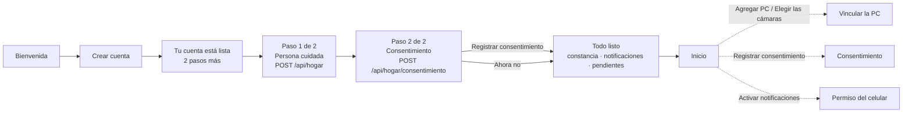

# Onboarding: two steps

After creating an account the owner goes through **two setup steps**, the person and the consent,
then «Todo listo». Up to 0.8.0 there were five. The PC, the family and the notifications are not
steps any more. Nothing was dropped: each item is still offered on «Todo listo», on Inicio or in
Ajustes, as before.

## Before and after

| | Up to 0.8.0 | From 0.9.0 |
|---|---|---|
| Welcome | Illustration of a room | The prototype's photo (`assets/imagenes/CREDITOS.md`) |
| «Tu cuenta está lista, Carmen.» | «5 pasos más:» and five items | «2 pasos más:» «Datos de la persona», «Consentimiento informado» |
| Step 1 | «Persona cuidada», `POST /api/hogar` (Paso 1 de 5) | The same screen (Paso 1 de 2) |
| Step 2 | «Consentimiento» (Paso 2 de 5), then the screen «Consentimiento registrado» | The same form (Paso 2 de 2). Its certificate now shows on «Todo listo» |
| Step 3 | «PC de la casa»: link the PC and choose its cameras | Not a step: Inicio's «Agregar PC» / «Elegir las cámaras» (after the consent), Ajustes › «Cámaras y PCs», the PC's QR |
| Step 4 | «Familia»: invite a family member | Not a step: Familia › «Invitar a un familiar» |
| Step 5 | «Avisos»: the notification permission | Asked on «Todo listo» |
| End | «Todo listo»: a summary | «Todo listo»: the certificate, the notifications, and what was left for later |

## Why each item is where it is

- **The person (step 1) stays a step.** `POST /api/hogar` creates the household, and every other
  screen needs it. The router keeps a session without a household on `/cuenta-creada` and
  `/configuracion/persona`.
- **The consent (step 2) stays a step, and nothing about it changed** (Ley N.° 29733; US-05):
  - it is explicit: two separate boxes that are never pre-checked, the live-view clause first and
    open (CA-05.4), and the full document one tap away;
  - it is recorded by the backend with its date and time, who gave it and who registered it
    (CA-05.3). «Todo listo» shows that certificate (`TarjetaConstancia`), and Ajustes › Privacidad
    keeps it;
  - it stays free: «Ahora no» still skips it. Detection then stays off (CA-05.2): Inicio says
    «Detección detenida» and offers «Registrar consentimiento», and «Todo listo» lists «Falta el
    consentimiento». It is never presented as optional for the detection itself.
  - The monitoring consent has no text-version field in the API contract (§2,
    `POST /api/hogar/consentimiento`); the app does not change the contract.
- **The movements consent is not part of onboarding**, as before. It is the separate, optional
  consent (US-35) with text version `3` (Microsoft Azure), registered from Ajustes › Privacidad ›
  «Guardar movimientos» with `versionTexto`.
- **The notifications are asked for on «Todo listo»**, right after the setup, when the owner knows
  what they are for. The same explanation comes first («Que no se te pase ninguna caída», «Aunque la
  app esté cerrada o el celular en silencio.»), and the phone's own prompt only comes from
  «Permitir» (CA-16.2). An iPhone browser tab first shows how to add the app to the home screen.
  If the owner does not allow them, Inicio keeps «Activa las notificaciones» with «Activar
  notificaciones» (CA-16.3).
- **The PC is deferred.** Linking needs Te Tengo Captura installed on the home's PC, which the owner
  often cannot do at sign-up. «Todo listo» says «Sin PC vinculada» · «Agrégala desde Ajustes ›
  Cámaras y PCs», and once the consent is registered Inicio's status card offers «Agregar PC» (or
  «Elegir las cámaras» once the PC is linked). The PC's QR (`/vincular?codigo=…`) still opens the approval screen. The pairing
  screens lost their setup mode (`config=1`, «Paso 3 de 5»), so they behave as from Ajustes.
- **The family is deferred.** «Todo listo» says «Sin contacto secundario» · «Invítalo desde
  Familia». Inviting works as before from Familia › «Invitar a un familiar» (US-08).

## Prototype mapping

The prototype (`05-prototipos/app-movil`, `pantallas/NN-*.png`) still draws the five-step setup.
This is how its screens map to the app:

| Prototype screen | App |
|---|---|
| `01-bienvenida` | Bienvenida, with its photo (`FotoBienvenida`) |
| `07-cuenta-creada` | «Tu cuenta está lista», with «2 pasos más:» and two items (new copy) |
| `16`, `17` datos de la persona | Paso 1 de 2 |
| `18`, `19`, `20` consentimiento | Paso 2 de 2 |
| `21-consentimiento-registrado-constancia` | In setup: the certificate on «Todo listo». From Inicio or Ajustes: the same screen as before |
| `22`, `23`, `24`, `25` PC de la casa | From Inicio («Agregar PC») and Ajustes › «Cámaras y PCs»; no «Paso 3 de 5» or «Hacerlo después» |
| `26-invitar-a-un-familiar` | Familia › «Invitar a un familiar» |
| `27-activa-los-avisos`, `28-permiso-del-celular` | The «Que no se te pase ninguna caída» block of «Todo listo» |
| `29-todo-listo` | «Todo listo», with the certificate and the notifications added |

## Where it lives

| What | Where |
|---|---|
| Routes and guards | `lib/app/rutas.dart` (`cuentaCreada`, `configPersona`, `configConsentimiento`, `configListo`), `lib/app/router.dart` |
| Step header «Paso N de 2» | `CabeceraConfiguracion.pasos` in `lib/core/ui/piezas.dart` |
| Screens | `pantalla_cuenta_creada.dart`, `pantalla_persona_setup.dart`, `pantallas_consentimiento.dart`, `pantalla_todo_listo.dart` |
| Tests | `test/features/sesion/registro_test.dart`, `test/features/hogar/persona_test.dart`, `consentimiento_test.dart`, `todo_listo_test.dart`; dark mode, 200 % text, contrast and accessibility of every setup screen in `test/calidad/` |
